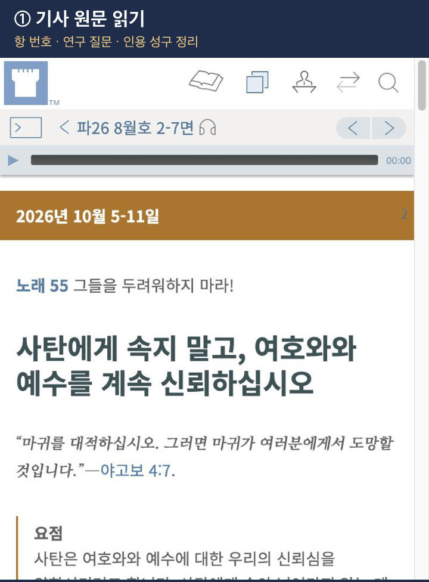
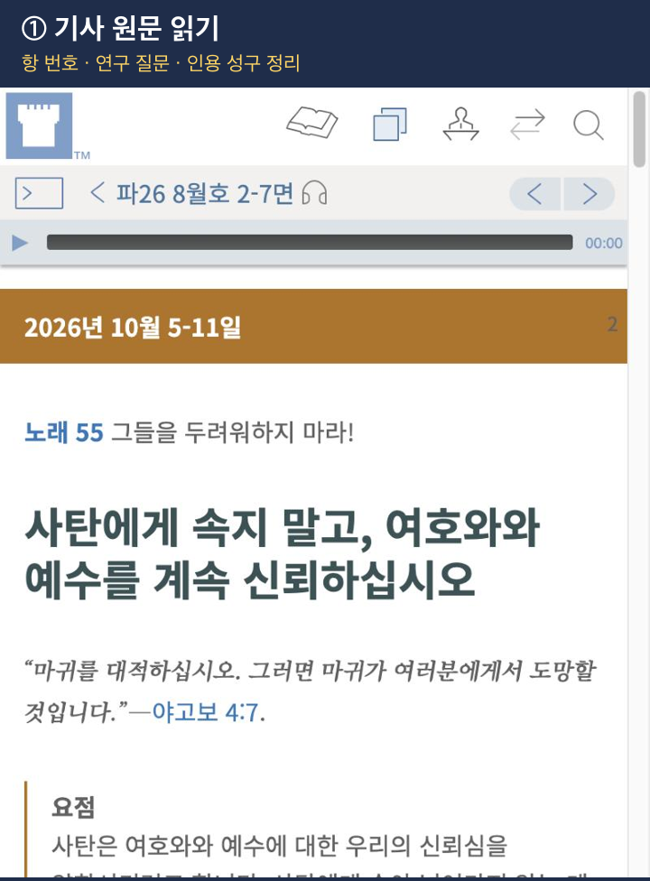
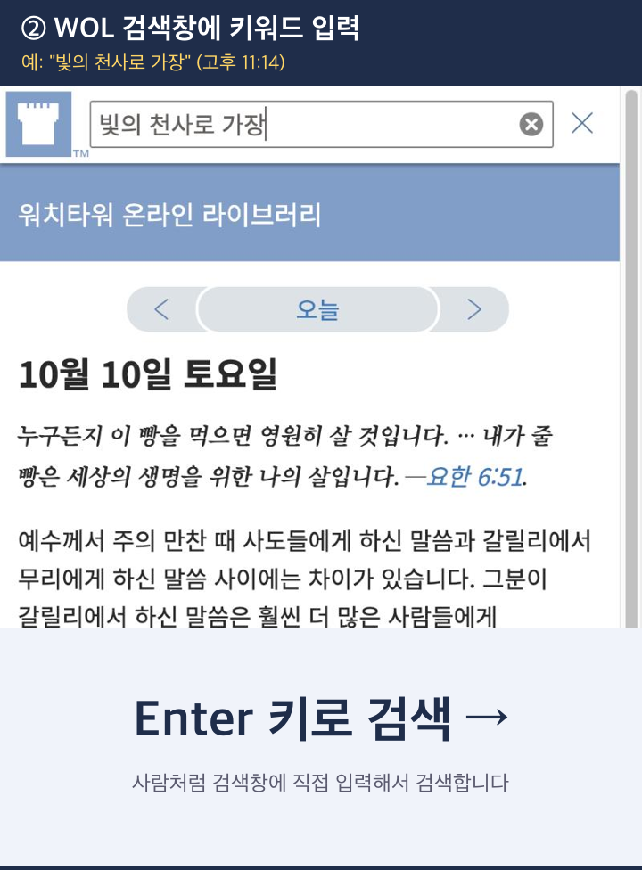
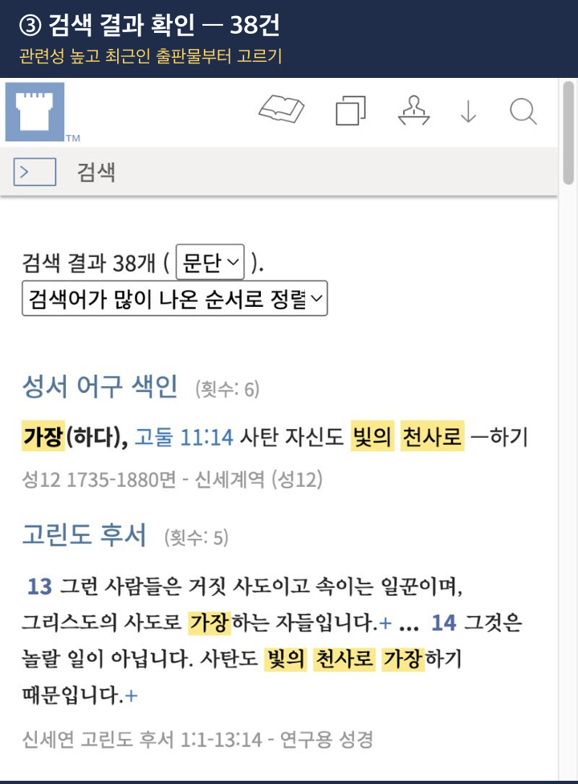
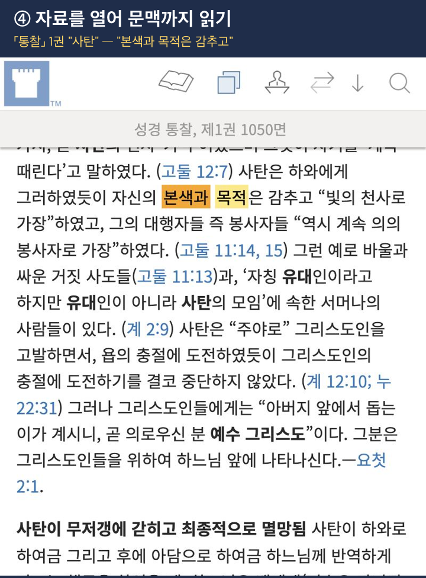
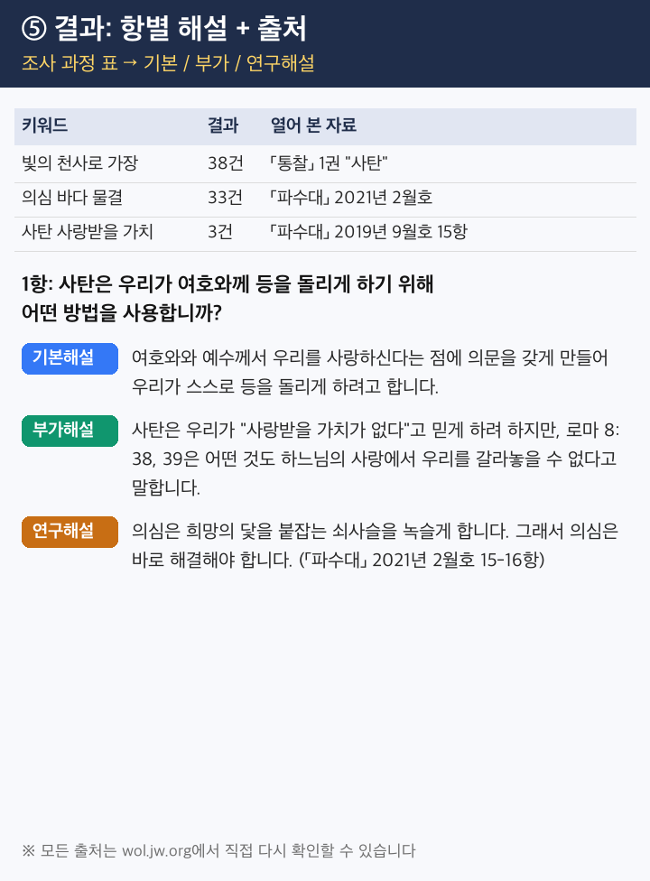

# Watchtower Study Comment Research Assistant

**English** | [한국어](README.md)

Give the AI a *Watchtower* article link. It searches and reads **only wol.jw.org**, then writes **Basic / Additional / Research** comments for each paragraph, with sources.



---

## Where to use it

| Where | Recommended | Notes |
|---|---|---|
| **Claude Code** (Code tab in the Claude desktop app) | ⭐ Best | You can watch the research live in the browser pane |
| **Codex** (ChatGPT's coding tool) | ○ Good | Verify through the research table and sources |
| **Claude chat + Chrome extension** | ○ Good | Watch the AI search WOL in Chrome (paid plan required) |
| **Claude chat** (without the extension) | △ Works | The research process isn't visible, and accuracy may be a little lower |

---

## Installation

### ① Claude chat
1. Download [`watchtower-comment-research.skill`](watchtower-comment-research.skill). Open the link and click the download button (↓) at the top right.
2. In Claude, go to **Settings → Capabilities → Skills** and upload the file.
3. On the same screen, make sure **web search** is on.

### ② Claude Code (desktop app Code tab)
1. Open the **Code** tab in the Claude desktop app.
2. Paste this message and send it:
   ```
   Install this skill into my Claude: https://github.com/suinegyzal/watchtower-comment-research
   ```
3. Approve when asked. When it's done, open a **new session**.

> If you already uploaded the skill in ①, it may already appear in the Code tab. Only do ② if it doesn't.

### ③ Codex
1. Open Codex.
2. Paste this message and send it:
   ```
   Install this skill: https://github.com/suinegyzal/watchtower-comment-research
   ```
3. Approve when asked. When it's done, restart Codex.
4. Turn on **web search** in Codex settings.

### ④ Chrome extension (Claude in Chrome)
Install this extension if you want Claude chat to **control your Chrome browser directly** while it researches WOL. You can watch the research as it happens.

> **Requirements:** a **paid Claude plan** (Pro, Max, Team, or Enterprise), **Google Chrome**, and a computer. Mobile devices and other browsers are not supported. This feature is currently in beta.

1. In Chrome, open the official extension page:
   👉 https://chromewebstore.google.com/detail/claude/fcoeoabgfenejglbffodgkkbkcdhcgfn
2. Click **Add to Chrome**.
3. **Sign in with your Claude account** when prompted.
4. Click the puzzle-piece (🧩) icon at the top right of Chrome, then click the **pin (📌)** next to Claude.
5. **Grant the permissions** it asks for.
6. Open wol.jw.org in Chrome, then click the **Claude icon** in the toolbar to open the side panel.
7. Send the article link and your request in the side panel. (See [Usage](#usage).)
   - If it asks whether it may access wol.jw.org, choose **Allow**.

> ⚠️ Some extensions from other companies have similar names (e.g., "Claude Toolbox"). Install only the **official Anthropic** extension from the link above.

---

## Usage

In a new chat or session, send the article link with a request:

```
This week's Watchtower article: https://wol.jw.org/ko/wol/d/r8/lp-ko/(article id)
Please prepare Basic, Additional, and Research comments for paragraphs 1–3.
```

You can follow up with requests like these:
- `Continue with paragraphs 4–6`
- `Dig deeper for the research comment on paragraph 5`
- `Make them shorter, under 30 seconds each`

> The skill writes in Korean by default. Ask for English to get English output from the English WOL.

### How it researches

| Step | Screen |
|---|---|
| **① Read the article**<br>List each paragraph's number, question, cited scriptures, and footnotes. |  |
| **② Search WOL**<br>Search 2–3 keywords per paragraph. If there are no results, shorten the keywords and try again. |  |
| **③ Pick results**<br>Start with the most relevant and recent publications. |  |
| **④ Open and read**<br>Check the surrounding context, not just the search snippet. |  |
| **⑤ Write it up**<br>A research table plus Basic / Additional / Research comments, with sources. |  |

### Tips
- Ask for **2–3 paragraphs at a time**. Asking for everything at once makes the research shallow.
- Spots for a personal experience are marked `[개인 경험]` (personal experience).
- **Always do the final check yourself.** Open the sources on WOL before using a comment.

---

## Notice
- This is a personal tool to help with meeting preparation. It is not an official tool of Jehovah's Witnesses or the Watch Tower Bible and Tract Society.
- Content and screenshots from jw.org are copyrighted by the Watch Tower Bible and Tract Society of Pennsylvania.
