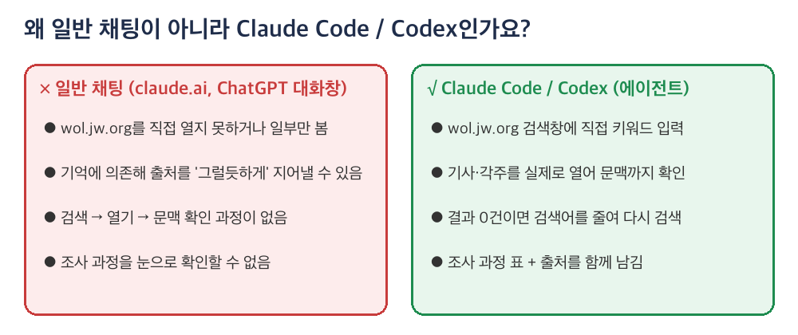
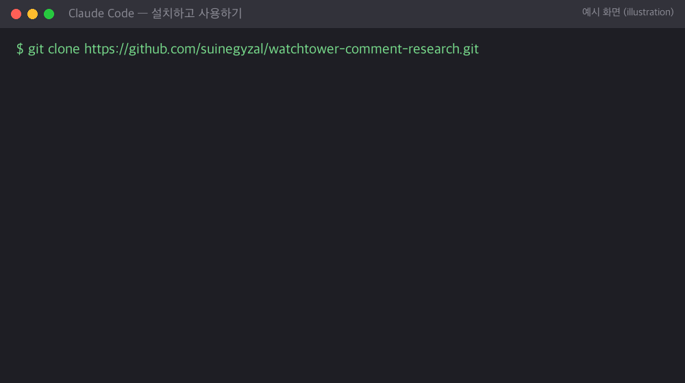
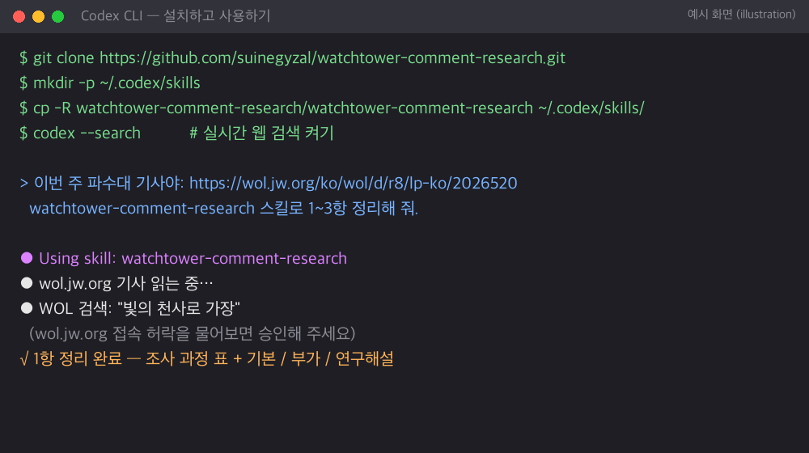

# Watchtower Study Comment Research Assistant

**English** | [한국어](README.md)

An AI skill that researches paragraph-by-paragraph comments for the *Watchtower* Study **using wol.jw.org only**. It organizes them into **Basic / Additional / Research** comments.

> This repository is private and visible only to invited people. Please don't share the link or files publicly.


---

## ⚠️ Read first: don't use this in a regular chat

Use this skill in an **agent** tool such as **Claude Code** or **Codex**. It is not designed for the regular chat window of claude.ai or ChatGPT.



A regular chat can't really search and open wol.jw.org step by step, so it may rely on memory and produce plausible-looking but unverified sources. This skill depends on **actually searching, opening, reading, and verifying**, which requires an agent tool.

| Tool | Recommended | Notes |
|---|---|---|
| **Claude desktop app → Code tab** | ⭐ Best | You can watch the research live in the built-in browser pane |
| **Claude Code (terminal)** | ○ | Verify through progress updates and the research table |
| **Codex CLI** | ○ | Turn on live web search (`--search`) |
| claude.ai / ChatGPT regular chat | × | Not recommended |

---

## How it works

The skill follows the same steps a person would take when researching on WOL.

| Step | Screen |
|---|---|
| **① Read the article**<br>List each paragraph's number, study question, cited scriptures, and footnotes. |  |
| **② Type keywords into WOL search**<br>Enter 2–3 keywords per paragraph. |  |
| **③ Review the results**<br>Pick the most relevant and recent publications. If there are 0 results, shorten the keywords and search again. |  |
| **④ Open and read in context**<br>Open the source and read the surrounding text, not just the search snippet. |  |
| **⑤ Write the result**<br>A research table plus Basic / Additional / Research comments with sources. |  |

> Steps ①–④ are real screenshots of wol.jw.org. The skill works on the Korean WOL and writes in Korean by default. Ask for English to use the English WOL instead.

**Rules it follows**
- **It never uses sites other than jw.org / wol.jw.org.**
- Anything it could not confirm is marked "source not confirmed."
- Spots for a personal experience are marked `[개인 경험]` (personal experience). Fill those in yourself.

---

## Installation

### A. Claude Code (desktop app Code tab / terminal)



```bash
git clone https://github.com/suinegyzal/watchtower-comment-research.git
mkdir -p ~/.claude/skills
cp -R watchtower-comment-research/watchtower-comment-research ~/.claude/skills/
```

- This is a private repo, so cloning requires a GitHub login. Run `gh auth login` first.
- Alternatively, use **Code → Download ZIP**, unzip it, and put the `watchtower-comment-research` folder into `~/.claude/skills/`.
- Restart Claude Code after installing. In the desktop app, open a new session.

### B. Codex CLI



```bash
git clone https://github.com/suinegyzal/watchtower-comment-research.git
mkdir -p ~/.codex/skills
cp -R watchtower-comment-research/watchtower-comment-research ~/.codex/skills/
codex --search
```

- `--search` turns on live web search. To keep it on, add `web_search = "live"` to `~/.codex/config.toml`.
- Approve access to wol.jw.org when Codex asks.
- If the skill doesn't show up, check that the folder contains `SKILL.md`, then restart Codex.

### Updating

```bash
cd watchtower-comment-research && git pull
cp -R watchtower-comment-research ~/.claude/skills/   # or ~/.codex/skills/ for Codex
```

---

## Usage

In a new session, send the article link with a request:

```
This week's Watchtower article: https://wol.jw.org/ko/wol/d/r8/lp-ko/(article id)
Please prepare Basic, Additional, and Research comments for paragraphs 1–3.
```

More examples:
- `Continue with paragraphs 4–6`
- `Dig deeper for the research comment on paragraph 5`
- `Make the comments shorter, under 30 seconds each`

**Tips**
- **Start with 2–3 paragraphs at a time.** Asking for all 18 at once makes the research shallow.
- **Always do the final check yourself.** Open each cited source on WOL and confirm the context before using a comment.

---

## Files

```
README.md / README.en.md            Guides (Korean / English)
watchtower-comment-research/        The skill → copy into ~/.claude/skills or ~/.codex/skills
  ├── SKILL.md                      Research rules and steps
  └── references/wol.md             WOL URL formats, Bible book numbers
watchtower-comment-research.skill   Zipped copy of the same skill
prompts/                            Original prompt text (reference)
docs/images/                        Images for this guide
```

## Notice

- This is a personal tool to help with meeting preparation. It is not an official tool of Jehovah's Witnesses or the Watch Tower Bible and Tract Society.
- Content and screenshots from jw.org are copyrighted by the Watch Tower Bible and Tract Society of Pennsylvania. Do not copy and redistribute publication content in bulk.
- The terminal images (Claude Code / Codex) are **illustrations**. Actual screens may differ by version.
